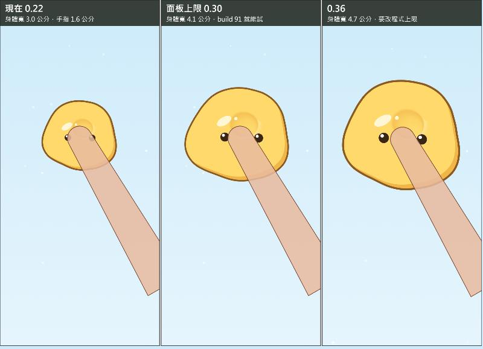

# 手感診斷（暫定）｜捏捏史萊姆

> 2026-11-04，回應多米：把史萊姆的手感做到極致，要像真的生物、會跟人互動，捏、揉、按的體感要好。
> 狀態：多米 11-04 按了「開始做 v2.24」，F1 到 F3 已做成 v2.24（網頁與 Swift），實作跟這份不同的地方見第二節 v2.24 底下。v2.25 以後還沒動。
> 更正（11-04 實作時量到）：原本寫「除了傾一下 2.3 毫米，反應都不到 1 毫米」太滿。2.3 毫米是拿設定值 0.16R 換算的，實際量外緣是 −0.7 點，被同時發生的縮一下吃掉，等於看不出來；而且漏了放手後的偽足探（4 到 9.5 毫米）。下面的表已改。
> 量法：網頁版 v2.23，iPhone 15 尺寸（393×852，每毫米 6.04 點），模擬手指，每小步 1/240 秒，跟 Swift 120Hz 的小步長相同。輕揉、搔癢、眼睛視線的門檻我對過 Swift，數字一樣。觸覺的強度是把 Swift 的公式套在網頁的物理上算的，手機實際震多強我量不到。
> 這份只寫量到什麼、打算怎麼改、我為什麼這樣猜。好不好捏要真機和沒看過的人（閘門 3），我的判斷不算數。

## 先講結論

v2.19 到 v2.23 一直在加反應。我跑了一段 60 秒的自然玩法（點、按、拖、揉、甩、放著），14 到 15 種反應都有觸發，光是「縮一下」就 14 次，數量夠了。我覺得卡住的是下面五件事，這五件以前都沒有換算成實體大小或手速量過。

| 問題 | 量到的 | 手上會是什麼感覺（我的猜測） |
|---|---|---|
| 身體太小 | 身體寬 3.0 公分，成人食指 1.6 到 2 公分。手指還按著時，它的反應（縮、傾、蹭、看、呼吸）在螢幕上都不到 1 毫米；放手後的偽足探才有 4 到 9.5 毫米 | 手指一放就蓋掉一大塊，按著的當下它回應了也不容易看到 |
| 沒有重量 | 放手 33 毫秒就彈完第一下，接著每秒晃 7 下。黏土彈回 20 點，0.2 秒內就停 | 像很小的橡皮，沒有一團東西的份量 |
| 揉不通 | 手指每秒超過 2.9 公分，它完全沒反應。來回揉到每秒 2 下，不到 4 秒它就掙脫逃走 | 最常做的動作，它不理你 |
| 觸覺幾乎是空的 | 揉的時候連續觸覺強度約 0.05（滿分 1）。果凍手停著比手在動還強 | 手上沒東西 |
| 生命跟手感分開 | 睡著、舒服、戒備時，按下去的物理參數完全一樣；呼吸和縮一下都是疊在物理上面的表演 | 手指感覺不到它現在的狀態 |

上圖是實際比例。手指照 1.6 公分寬畫，接觸面直徑抓 1 公分（估計值，真機看面板「指 pt」校正）。

## 一、量到的數字

### 1. 尺寸與反應幅度

身體寬 184 點、高 159 點。v2.10 為了留空間拉長，把身體從 0.26 縮到 0.22；v2.12 之後有鏡頭跟著拉遠，那個理由現在用不太到了。手指按在中間時，身體被蓋掉 28%（0.30 是 21%）。

| 反應 | 螢幕上（點） | 毫米 |
|---|---|---|
| 呼吸（放著） | 最大 3.9，平均 2.1 | 0.6 |
| 呼吸（按著） | 最大 4.8 | 0.8 |
| 縮一下 | 5.4 | 0.9 |
| 傾一下（外緣實際多出來的） | −0.7（被縮一下吃掉） | 看不出來 |
| 伸偽足探（放手 0.5 秒後才有） | 26 到 57 | 4 到 9.5 |
| 蹭手指 | 左右 4.3 | 0.7 |
| 眼睛看 | 橫 5.2、直 3.9 | 0.9 |
| 熟的姿勢 | 寬 1.7、高 4.3 | 0.3、0.7 |
| 戒的姿勢 | 寬 3.5、高 5.2 | 0.6、0.9 |
| 舒服攤軟 | 寬 4.3、高 5.2 | 0.7、0.9 |
| 發抖 | 1.4 | 0.2 |

這些都寫成「半徑 R 的幾成」，二十幾版下來沒有換算過實體大小。v2.11 多米要自身形變小，指的是沒事時一直在動；對你的反應可以另外放大，這是兩回事。

眼睛 14×20 點、沒有眼白，看的方向只靠整顆平移 5.2 點，按在身體中間時兩顆又剛好被手指壓到邊。v2.23 判斷缺的是注視，我同意這個判斷，但 5 點的位移可能讀不成「在看你」。

### 2. 按壓

| 時間 | 黏土輪廓最大位移（按中間） |
|---|---|
| 第一幀 | 4.0 點 |
| 0.2 秒 | 8.2 點 |
| 1 秒 | 15.9 點 |
| 放手 0.1 秒 | 13.7 點 |

第一幀就有反應，這段 v2.16 做到了。卡的是看得到的地方：凹痕半徑 17 到 26 點，手指接觸面半徑約 30 點，按著的時候整個凹痕都在手指底下，放手才看到，然後 0.6 秒退完。按著時看得到的只有整圈外框變大、眼睛被擠開。局部鼓起（候選 27）預設關。

身體放大到 0.30 時，畫面上看得到的變化面積是現在的 1.9 倍（4839 變 9162 平方點，手指蓋住的已扣掉）。

### 3. 放手

抓右緣拉 1R，停 0.5 秒放手，用每秒 240 次取樣追尖端。

| 材質 | 第一下彈完 | 接著每秒晃 | 尖端最快（點／秒） | 放手 1 秒還留 |
|---|---|---|---|---|
| 黏土 | 29 毫秒 | 7.3 下（幅度很小） | 1177 | 78% |
| 麻糬 | 33 毫秒 | 4.4 下 | 3557 | 6% |
| 果凍 | 33 毫秒 | 6.9 下 | 3705 | 3% |

面板的「晃動阻尼」幾乎調不動週期：果凍 0.986 改 0.994，週期一樣。「回彈硬度」調得動，但會交叉：果凍 0.14 在 0.22 的身體上 20 幀交叉，0.1 在 0.30 的身體上 26 幀。

所以我試了另一個做法，只跑在記憶體裡：參考形狀帶慣性。現在身體直接被拉回記住的形狀 Q；實驗多一層 QD，QD 用一條彈簧追 Q（每秒 3 下、阻尼比 0.22），身體改追 QD。放手那一刻 QD 接住身體當下的形狀，再帶著身體當下六成的相對速度，所以不會一幀彈回去，整個回彈的快慢由這條彈簧決定。

| 材質 | 第一下 | 每秒晃 | 尖端最快 | 1 秒還留 | 暴力玩法交叉幀（共 831 幀） |
|---|---|---|---|---|---|
| 黏土 | 29 變 167 毫秒 | 約 3 下 | 1177 變 233 | 78 變 79% | 0 變 8（0.30 的身體是 0） |
| 麻糬 | 33 變 163 毫秒 | 4.4 變 2.9 | 3557 變 883 | 6 變 7% | 0 變 0 |
| 果凍 | 33 變 167 毫秒 | 6.9 變 3.0 | 3705 變 895 | 3 變 5% | 0 變 0 |

多米要的留形沒被動到（黏土 78 變 79%），硬度也不用降。黏土那 8 幀要先解。這組數字只證明算得出來、不容易壞，有沒有份量要真機摸。

### 4. 跟手

等速拖 0.5 秒，量被抓那塊落後手指多少。

| 材質 | 黏滯 lag | 落後 | 手指每秒 500 點時差幾點 |
|---|---|---|---|
| 黏土 | 0.12 | 130 毫秒 | 65 |
| 麻糬 | 0.08 | 150 毫秒 | 79 |
| 果凍 | 0.05 | 130 毫秒 | 67 |
| 黏土 lag 0.03 | 0.03 | 55 毫秒 | 28 |

這還沒算手機本身的延遲。書上說實驗室裡約 25 毫秒以上拖曳表現就下降（🟢，實驗室設備）。提案第 6 條寫「這是整份裡我最想先測的一條」，到現在沒測。多米 10-31 在網頁版摸 0.12 回「都對」，所以這條不預設答案，交給盲測。

注意：黏土只改 lag 0.03，在 0.22 的身體上暴力玩法有 45 幀交叉，放大到 0.30 是 0 幀。甩的那段我用固定點數，大身體相對受力比較小，這個 0 幀定案前要照 selftest 連跑確認。

### 5. 揉

用黏土，全部行為打開，揉 8 秒（程式碼 `index.html:975`、`SlimeRig.swift:349`：`手指每秒 2R 以內才算輕揉`，2R 就是每秒 2.9 公分）。

| 揉法 | 每秒幾公分 | 它的反應 |
|---|---|---|
| 小圈，半徑 1.7 毫米，一秒 1 圈 | 1.0 | 2.2 秒開始呼嚕 |
| 小圈，半徑 2.5 毫米，一秒 1.5 圈 | 2.3 | 2.2 秒開始呼嚕 |
| 小圈，半徑 3.3 毫米，一秒 1.5 圈 | 3.0 | 8 秒都沒反應 |
| 圓圈，半徑 5 毫米，一秒 1 圈 | 3.1 | 8 秒都沒反應 |
| 圓圈，半徑 5 毫米，一秒 2 圈 | 5.8 | 8 秒都沒反應 |
| 圓圈，半徑 6.6 毫米，一秒 2 圈 | 7.8 | 8 秒都沒反應 |
| 來回 ±3.3 毫米，一秒 1 趟 | 1.3 | 2.1 秒開始呼嚕 |
| 來回 ±5 毫米，一秒 1.5 趟 | 2.9 | 8 秒都沒反應 |
| 來回 ±5 毫米，一秒 2 趟 | 3.7 | 0.9 秒開始搔癢，3.9 秒掙脫逃走 |
| 來回 ±5 毫米，一秒 3 趟 | 5.2 | 0.6 秒開始搔癢，3.6 秒掙脫逃走 |

8 秒都沒反應那幾列，熟、戒、心情全部是 0。開頭那段 60 秒的自然玩法裡，呼嚕一次都沒出現。按住不動倒是算輕揉，所以按著會熟，揉卻不會。第 0u 輪我的自測揉太快不算輕揉，當時是把測試放慢到每秒 1.1R 讓它過，沒回頭問真人的手速，這個洞就留到現在。

畫面也幾乎沒變化：身體內部是平塗，手指拖超過 0.15R 凹痕開始淡，超過 0.4R 收掉。實際揉的時候紅圈附近什麼都沒有，只有外框跟著歪。

還有一個副作用：v2.14 為了「從中間拉得動」加的補抓，手指動 0.12R 就觸發，揉的時候也會把一條粒子抓到外圈，9 個外圈點被釘在手指上。輪廓相鄰兩段的最大折角：靜止 14 度，揉（半徑 5 毫米、一秒 1.5 圈）43 度，關掉補抓 16 度；拉扯過之後再用半徑 5.8 毫米、一秒 2 圈揉，到 93 度。畫面上是外框右緣的一個小折角。

### 6. 摸

手指從身體左半劃過身體到右外側（走 208 點），整團被帶走：黏土 74 點、麻糬 90 點、果凍 113 點，放手再滑到 119、150、180 點。現在沒有「摸」這個動作，任何落在身上的手指都把那一塊釘住（`index.html:546`、`index.html:634`）。對一隻動物做的第一件事，到這裡會變成把牠拖走。

### 7. 觸覺

連續觸覺強度照 Swift 公式（變形量^1.5 × 0.8）算，滿分 1，低於 0.03 不啟動。

| 情境 | 黏土 | 麻糬 | 果凍 |
|---|---|---|---|
| 按住 0.1 到 1 秒 | 0.076 | 0.102 | 0.086 |
| 拖（每秒 300 點） | 0.084 | 0.123 | 0.099 |
| 拖完手停著 | 0.049 | 0.241 | 0.173 |
| 揉（半徑 5 毫米，一秒 1.5 圈） | 0.050 | 0.075 | 0.067 |

麻糬和果凍手停著比手在動還強，方向反了。候選 12（跟變化率）開了之後，黏土揉也只有約 0.10，因為記形把變形量吃掉，變化率很小，光開這條不夠。按住時每次吸氣那一下是 0.11、銳利度 0.05。

我查不到 iPhone 多低就感覺不到的公開數字，這題只能真機答。13 輪真機回報沒有一次提到震動，問過兩次按住時的輕震也都沒回，我猜可能根本沒感覺到。

### 8. 流程

參數表自己寫「到現在還沒有一個參數做過盲測」。面板有 17 條寫好的候選預設全關，包含按壓面積、質地微震、放手餘韻。測試紀錄 37 輪裡 14 輪是多米自己（只算方向）、23 輪是程式，新的手 0 輪。`閘門紀錄.md` 還不存在，閘門 3 沒量。v2.3 到 v2.23 是 11-01、11-02 兩天做的，加得比測得快。

## 二、要做的事，照順序

每一條兩版都做、面板有開關可以回上一版，照舊 selftest 連跑。數字全部是起點。

### v2.24 看得到

| 編號 | 改什麼 | 起點 | 風險 |
|---|---|---|---|
| F1 放大 | 身體預設 0.30，放寬 `H*.14` 上限和 `camFill` 後試 0.34 到 0.36。粒子數跟 R 無關，運算量不變 | 寬 4.1 公分，反應全部大 1.36 倍 | 走路比較快出畫面、拉長時鏡頭提早退 |
| F2 對你的反應放大 | 只放大對手指的反應，休息時的呼吸、蠕動不動。眼睛改成整張臉在身上滑，被手指蓋到時滑開 | 縮一下 5% 變 10%；傾 0.16R 變 0.28R；蹭 0.05R 變 0.12R；看 0.06R 變 0.18R | 過頭會像卡通抽搐；減少動態減半 |
| F3 揉的門檻 | 輕揉上限改用實體速度；搔癢改成很快又很小的撥；掙脫前先發抖警告；補抓只在真的往外拉時才觸發 | 上限每秒 12 公分；搔癢要一秒 4 趟以上、±3 毫米內；掙脫 6 秒；呼嚕 1.2 秒來；補抓門檻 0.6R | selftest T33、T37 要跟著改 |

實作跟上表不同的地方（11-04，理由都是量出來的）：

- 傾一下：鼓包 0.28 外緣只多 0.07R，所以多加整團靠過去 leanMove 0.11，外緣實際多 16.8 點（約 2.8 毫米，v2.23 是 −0.7 點）。
- 鏡頭：多做 camGrip。放大身體後量到拉 100 點，手指跟被抓那塊差 93 點；v2.23 拉 70 點就差 79 點，往下拉 300 點差 145 點。原因是拉開 0.5R 鏡頭就對準形狀中心，連上下都動。改成抓著時不平移，放不下才以手指為中心拉遠，放手 1.2 秒內形狀太靠邊才挪回來；沒抓著時鏡頭只看記住的形狀，不看偽足。
- 記形：多做 pressLocal。按著不動 4 秒外框折出 50 度尖角，是遠端把形狀匹配的小誤差記下來。提高定型門檻會讓留形變差（0.14 時 1.5R 拉的留形 0.79 變 0.70），撫平尖角會磨短拉出來的尖端（0.6），所以改成手指拖開 0.15R 之前只有手指附近記形，拉的留形不受影響。搔癢時不記形。
- 搔癢：一秒 3 趟（tickRev 6）、每段 48 點（tickSeg），段長用手指實際走的路徑量。
- 補抓：拉開 0.5R 才補（起點 0.35R 擋不住半徑 8 毫米的揉），手指回到起點 0.25R 內解開。

v2.24 實際量到的幅度（點，括號是毫米）：

| | v2.23 | v2.24 |
|---|---|---|
| 身體寬 | 177（29） | 241（40） |
| 縮一下 | 5.4（0.9） | 14.8（2.5） |
| 傾一下，外緣 | −0.7（看不出來） | 16.8（2.8） |
| 蹭，整團擺幅 | 8.3（1.4） | 26.9（4.5） |
| 看，臉滑多遠 | 5.2（0.9） | 21.2（3.5） |
| 拉 70 點停住，手指跟被抓那塊差 | 79 | 3 |
| 往下拉 300 點停住，手指跟被抓那塊差 | 145 | 12 |

### v2.25 有重量、手上有東西

| 編號 | 改什麼 | 起點 | 風險 |
|---|---|---|---|
| F4 參考形狀帶慣性 | 第一節第 3 點的實驗做成正式參數，放手、甩、拖到一半停都會晃一下 | 每秒 3 下、阻尼比 0.22，三種材質各自調 | 黏土 8 幀交叉先解；記形要跟帶慣性的參考形狀比，晃動才不會被記下來 |
| F5 觸覺重做 | 揉、拖：手指走多遠給多少顆粒，手停就停。拉長：越拉顆粒越密。按下去：第一下之後 0.3 秒內 3 到 5 顆漸弱，用時間和 majorRadius 代替力道（3D-Press 的想法）。放手：照材質。連續嗡嗡只留給呼嚕。面板加「觸覺階梯」，點一下震一個強度，先知道多米的手機幾分感覺得到 | 顆粒間距 8 點、強度 0.15 到 0.35、每秒最多 25 下 | 一秒幾十下會手麻（🔴），三分鐘段記有沒有甩手、換手；舊機另外比 |

### v2.26 摸得到表面

| 編號 | 改什麼 | 起點 | 風險 |
|---|---|---|---|
| F6 摸跟抓分開 | 手指落下 80 毫秒內就在移動算摸；停住或接觸面變大算抓。摸的時候不釘粒子，手指是一顆會滑的圓頭（程式裡的 push 模式），身體最多被帶 0.2R，皮膚跟著凹一條，算進舒服。抓照現在 | 80 毫秒、每秒 150 點 | 想快速拉的人會被判成摸。用多米 build 77 錄影那種拉法驗；這條最可能要退回 |
| F7 手指旁邊看得到 | 凹痕半徑放到手指的 1.5 到 2 倍，手指外面看得到一圈陰影和亮邊；揉的時候凹痕跟著走，留 0.5 秒的尾巴；局部鼓起（候選 27）打開；亮光跟著局部拉伸變形 | 畫風維持平塗，先給多米看靜態圖再做 | 畫風是多米的決定 |

### v2.27 它的身體會變

| 編號 | 改什麼 | 起點 | 風險 |
|---|---|---|---|
| F8 肌肉 | 狀態直接改物理。睡著、舒服：按得深、沉得慢、觸覺鈍。戒、剛被扯：按得淺、回得快、觸覺脆。揉 3 秒以上看得到它慢慢放鬆，同樣一按深 1.5 倍 | 按壓深度 0.7 到 1.5 倍，銳利度 ±0.15 | 跟黏土的記形互相影響，要量記形有沒有跟著變 |
| F9 自己把形狀收回來 | 黏土退形的總速度不變（15 秒退一半），改成集中在每次呼吸收縮那一下，一段一段收，看得出它在出力 | 每次收縮收約 13% | 多米 v2.14 嫌回彈快，總速度不准變快 |
| F10 手指下的呼吸 | 按住超過 1 秒，每次吸氣輪廓鼓起來，連續觸覺跟著慢慢起伏，同相位 | 強度 0.05 到 0.25，銳利度低 | 感覺得到才有用，等 F5 的階梯結果 |

## 三、build 91 現在就能試

長按左上「捏捏」1.2 秒開面板。每一列都是：存 1，改，存 2，切 1、切 2 各捏一分鐘。多米自己捏只算方向。

| 順序 | 改什麼 | 想看什麼 | 我跑過的結果 |
|---|---|---|---|
| 1 | 身體大小 0.30 | 按的時候看不看得到它；拉長還夠不夠 | 三種材質暴力玩法 0 幀交叉 |
| 2 | 在 0.30 上，黏滯 0.03 | 拖起來有沒有比較跟手，黏的感覺還在不在 | 0 幀交叉；0.22 上 45 幀，所以要先放大 |
| 3 | 候選「13 質地微震」 | 揉的時候手上有沒有東西、會不會手麻 | 網頁沒有觸覺，沒測 |
| 4 | 候選「9 接觸面積壓力」，同時看面板第一行「指 xx pt」 | 輕按跟重按數字差多少，攤開程度有沒有差 | 網頁沒有接觸面積，沒測 |
| 5 | 在 0.30 上，黏土：回彈硬度 0.10、晃動阻尼 0.985、定型速度 3；麻糬：0.14、0.985；果凍：0.14、0.99 | 放手有沒有份量（第 5 列一次改三個，算一條候選） | 0 幀交叉。黏土放手 1 秒只留 68%，你可能又會覺得回彈太快；F4 不會有這個問題 |

## 四、只有多米量得到的

做完 v2.25 之後，這三件事再不做，後面的手感判斷都沒有依據。

| 事情 | 怎麼做 | 算哪一條 |
|---|---|---|
| 延遲 | 面板打開「延遲測試」，240fps 慢動作拍手指碰到螢幕到閃白，數格，一格約 4 毫秒 | 閘門 3 第 1 條 |
| 掉幀 | 手邊最舊的 iPhone 開低電量，最大幅度捏，看面板第一行的 Hz、最長幀、掉幀數 | 閘門 3 第 2 條 |
| 新的手 | 找一個沒看過的人，只說「你可以玩玩看」就走開。記 10 秒和 3 分鐘兩段：捏多久才放下、有沒有笑、放下後有沒有再拿起來。不問意見 | 閘門 3 第 3、6 條 |

## 五、手感以外（這次不動）

核心動作卡沒過閘門 1，三個測試都還沒做。`README.md` 還寫 v2.2 和 radial-v1，跟現況差很遠。舊版對照開關累積很多，每多一條功能兩版都要改、selftest 都要關，手感定案後要收一輪。

## 查證紀錄（2026-11-04）

| 問題 | 查到什麼 | 怎麼用、限制 |
|---|---|---|
| [3D-Press（Kildal 2010）](https://dblp1.uni-trier.de/rec/conf/icmi/Kildal10.html) | 硬表面上按壓，依壓力變化給細顆粒振動，會覺得表面陷下去。我只查到書目和[後續研究](https://hci.cs.uni-saarland.de/wp-content/uploads/projects/haptic_interfaces/electrotactile_complinace_illusion/jingu_chi24_electrotactileComplianceIlusion.pdf)的描述，沒讀到原文 | F5 按下去的顆粒。原研究有力道感測，iPhone 沒有，用時間和 majorRadius 代替是我的猜測 |
| [Elastic Images（Argelaguet 等 2013）](https://hal-univ-rennes1.archives-ouvertes.fr/hal-00907775) | 點圖片，圖片局部形變，不用觸覺裝置也感覺得到彈性，受試者最多分得出 8 級硬度。只看了摘要 | F7、F8：局部形變本身就在傳遞軟硬。沒有人在這隻史萊姆上測過 |
| [Löken 等 2009](https://pubmed.ncbi.nlm.nih.gov/19363489/) | 刷皮膚時，每秒 1 到 10 公分最舒服，也是 C 觸覺纖維反應最強的速度。數字來自二手描述，沒讀到全文 | F3 上限的參考。那是皮膚被刷，手機上是手指滑玻璃，不能直接搬 |
| [Haptic Creature](https://www.cs.ubc.ca/labs/spin/sites/default/files/local_pdfs/2011_DesignAndAssessmentoftheHapticCreature%27sAffectDisplay.pdf)、[Sefidgar 等 2016](https://www.cs.ubc.ca/labs/spin/sites/default/files/local_pdfs/Design_and_Evaluation_of_a_Touch-Centered_Calming_Interaction_with_a_Social_Robot.pdf) | 貓大小的機器人，用呼吸、呼嚕、耳朵變硬表達狀態；人撫摸會呼吸的那隻，心跳和呼吸率比摸不會呼吸的低 | F8、F10 的設計方向。實體機器人，不外推到手機。核心動作卡規定文案不做療效說法，這裡也不寫 |
| 手指寬度 | 只查到一個沒列出處的網頁寫成人食指 1.6 到 2 公分，找不到原始研究；[接觸面積](https://khub.utp.edu.my/scholars/6358/)因人、力道、角度差很多 | 圖用下限 1.6 公分，都算估計值。接觸面 1 公分是我的估計，真機看面板校正 |
| [Core Haptics 強度](https://www.kodeco.com/10608020-getting-started-with-core-haptics) | 強度、銳利度都是 0 到 1 的相對值，查不到可感門檻和實際頻率的官方數字 | F5 先做觸覺階梯，讓真機回答 |
