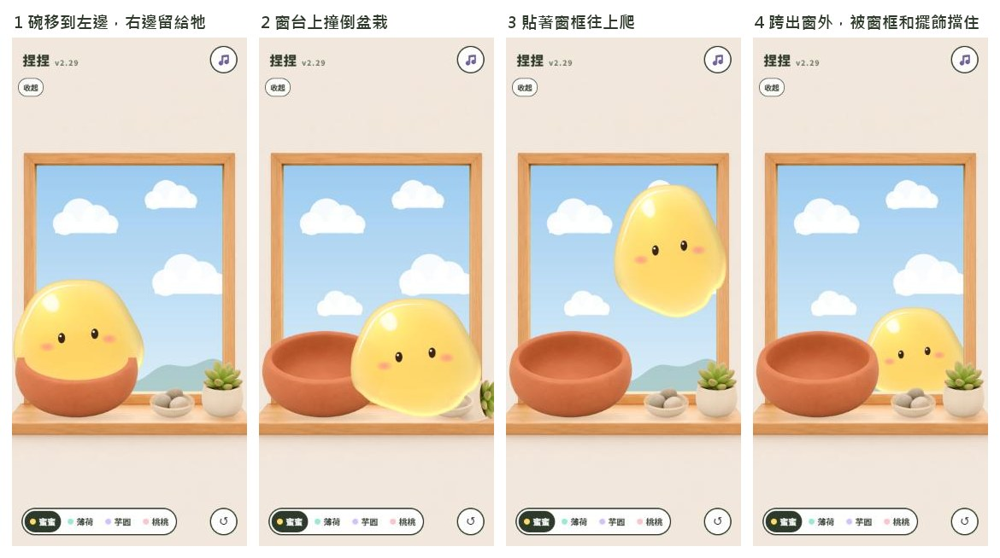

# 環境互動提案（暫定）｜捏捏史萊姆

> 2026-11-06，回應多米：「我想要史萊姆可以跟環境有真實互動，比如可以跨出窗外或是爬窗邊，或是打翻擺飾，以及爬出碗或爬進碗內。」
> 狀態：提案，等多米點頭才動工。

## 現在哪裡不真實

| 你看到的 | 程式現在怎麼做 |
|---|---|
| 進出碗 | 跳一下，碗只有裡面會擋。牠在窗台上時可以直接走過碗 |
| 擺飾 | 畫在背景圖上，碰不到 |
| 窗戶 | 碰不到窗框。窗戶上是「黏著滑下來」，窗外到不了 |

## 我建議的做法

把窗台拆成前後三層，每層有自己的地板和牆。牠換層的那一刻身體剛好不跟任何東西重疊，所以換層看不出來跳了一下。

| 層 | 從前面數 | 地板 | 會撞到什麼 | 畫的順序 |
|---|---|---|---|---|
| 窗台 | 最前面 | 木頭窗台 | 擺飾、畫面左右 | 蓋在碗和擺飾前面 |
| 窗框 | 中間 | 窗框下緣 | 左右窗框、上窗框、碗的側面 | 蓋在窗框上，被碗和擺飾擋住 |
| 窗外 | 最後面 | 窗框後面的外牆台階 | 只有台階 | 被整個窗框擋住，身體縮小約兩成 |

四件事的樣子：

- **爬進、爬出碗**：拿掉跳。牠先伸一條偽足搭上碗口，身體慢慢拉上去、翻過碗口，再流進碗裡。出來反過來，從碗口前面流到窗台上。碗口會真的擋住身體，看得到被碗口壓出一條凹線。
- **打翻擺飾**：盆栽和石頭盤變成真的物體，有重量、會倒、會滾。你把牠甩過去會撞倒，牠走過去會推倒。牠偶爾會像貓一樣，伸偽足慢慢推，邊推邊看你。掉到畫面外會聽到一聲，過一陣子新的回來；你也可以用手指扶正，按重來鍵也全部歸位。
- **爬窗邊**：牠從碗翻過碗後緣落到窗框下緣（實作時改的：擺飾把窗台右邊擋住，沒地方從窗台直接上去，2026-11-06），貼著左右窗框往上爬，爬到上面倒掛著走，再從另一邊下來。你把牠慢慢放到窗框旁邊，牠會黏住。拉下來或甩一下就掉。原本「黏在窗戶玻璃上滑下來」拿掉，因為窗戶是開著的。
- **跨出窗外**：牠爬上窗框下緣，翻過去，掉到外面。身體變小一點，下半身被窗框擋住，在窗外左右走，還可以走到牆後面只露半邊。你抓露出來的部分就能把牠拉回房間，放著不管牠過一陣子會自己爬回來。

它自己會做，你也推得動。手指拉牠的手感一條都不改：環境只是多了碰撞和行為，放在手感基準外面。

## 要你點頭的一件事

碗要從正中間移到左邊（圖一），身體大小不變。原因是碗有 205 點寬，放中間時窗框下緣左右各只剩 53 點，身體 180 點寬放不下，牠爬上窗框時整隻會被碗蓋住，窗外也幾乎看不到牠。

| 方案 | 好處 | 代價 |
|---|---|---|
| 碗移到左邊（我建議） | 右邊三分之二的窗框和窗外看得清楚，地方夠牠走 | 畫面不對稱 |
| 碗留中間，身體和碗都縮小約兩成半 | 畫面對稱 | 身體只剩約 135 點寬，手指蓋掉更多，你 build 86 之後放大過一次，這條是往回走 |
| 碗留中間，尺寸不變 | 不用改版面 | 窗框和窗外大半被碗擋住，跨出窗外不好看 |

示意圖：

## 施工順序

先網頁，每片都有開關，照舊 selftest 連跑，手感基準 T45 不准退步。Swift 等網頁定了再一起移植，TestFlight 等你開口。

1. 版面：碗移位，擺飾變成獨立物體（會倒、會滾），牠撞得倒。
2. 爬進、爬出碗。
3. 窗框層：爬上窗框下緣、貼著窗框爬、黏住。
4. 窗外層：翻出去、在外面走、自己回來。
5. 牠自己的行為：想出門時從這些裡挑；像貓一樣推擺飾。

## 我打算假設、你可以推翻的

- 窗戶是開著的，沒有玻璃。
- 掉到畫面外的擺飾過約 20 秒會回來，不會永遠不見。
- 窗外不會掉到看不見的地方再也回不來，最遠走到牆後露半邊。
- 爬的時候臉保持大致朝上，不跟著身體轉過去。
- 牠自己推擺飾的頻率不高，熟的時候多一點；你討厭這個就關掉。

## 不做

- 不動手指抓、拖、摸、放的任何參數。
- 不換皮、不選 A 或 B。
- 不加新角色、不加新反應種類。
- 窗外不做其他場景（鄰居、路人）。
